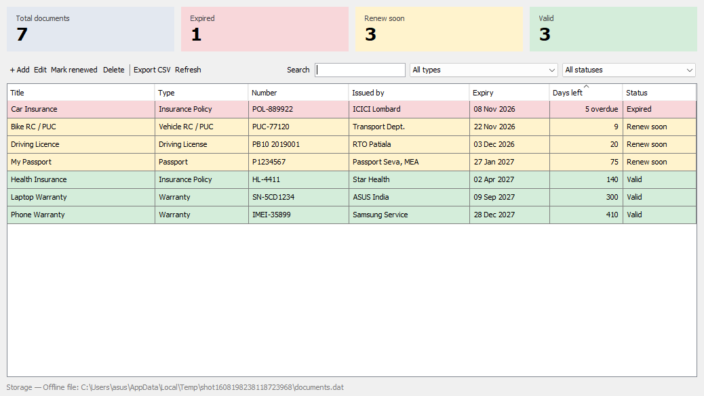

# Personal Document Expiry Tracker

A Java desktop app (Swing + MySQL/JDBC) that keeps track of when your passports, driving licences, insurance policies, warranties and similar documents expire, and reminds you before they do.



The full project report is in [docs/Project_Report.pdf](docs/Project_Report.pdf). It covers the problem statement, feasibility, requirements, design diagrams, implementation, screenshots and test cases.

## Features

- **One place for every document.** Store the title, type, document or policy number, issuer, issue date, expiry date and notes.
- **Automatic status.** Each document is marked **Expired** (red), **Renew soon** (amber, inside its reminder window) or **Valid** (green).
- **A reminder window for each document.** It defaults by type: a passport warns you 180 days ahead, an insurance policy 15 days, a driving licence or warranty 30 days. You can change it on any document.
- **Reminders:**
  - When the app starts, a pop-up lists everything that is expired or due soon.
  - A Windows desktop notification comes from the system-tray icon. The app checks again every hour and sends at most one notification per document per day.
- **Dashboard cards** show the total and the count for each status. Click a card to filter the table to that status.
- **Search** across title, number, issuer and notes, with filters for type and status. The table is sorted by urgency.
- **Mark renewed** suggests the next expiry date and keeps the same validity length as last time.
- **Export to CSV**, add, edit (double-click a row) and delete (with a confirmation).
- **Offline fallback.** If MySQL can't be reached, the app offers to keep your data in `data/documents.dat` instead.

## Tech stack

| Layer | Technology |
|---|---|
| UI | Java Swing (JTable, JDialog, SystemTray) |
| Logic | `ReminderService` (pure Java, unit-tested) |
| Data access | DAO pattern: `MySqlDocumentDao` (JDBC with PreparedStatements) and `FileDocumentDao` (offline) |
| Database | MySQL 8 (`sql/schema.sql`) |

```
src/com/doctracker/
  Main.java                 entry point, chooses MySQL or offline storage
  model/                    Document, DocumentType, ExpiryStatus
  dao/                      DocumentDao interface + MySQL / file implementations
  service/ReminderService   status, reminder and renewal rules
  ui/                       MainFrame, DocumentDialog, DateField, AppIcon
test/com/doctracker/SelfTest.java
sql/schema.sql              database, table and sample data
```

## Setup

1. Install **JDK 17 or newer**.
2. Install **MySQL Server 8** and remember the root password.
3. Download **MySQL Connector/J** from <https://dev.mysql.com/downloads/connector/j/> (choose "Platform Independent") and copy `mysql-connector-j-x.x.x.jar` into `lib\`.
4. Put your MySQL user and password in `db.properties`.
5. Optional: load the sample data. The app creates the database and table by itself if you skip this.
   ```bash
   mysql -u root -p < sql/schema.sql
   ```

## Run

```bash
build.bat
```

```bash
run.bat
```

To run without MySQL:

```bash
run.bat --offline
```

## Tests

```bash
test.bat
```

This runs 17 checks on the status and reminder rules, the renewal suggestions and the offline store. It doesn't need MySQL.

## Database design

There is one table, `documents`, with these columns:

- `id`
- `title`
- `doc_type`
- `doc_number`
- `issuer`
- `issue_date`
- `expiry_date`
- `reminder_days`
- `notes`
- `created_at`
- `updated_at`

`expiry_date` has an index because every screen sorts or filters by it.

A document's status comes from today's date, `expiry_date` and `reminder_days`:

- `days_left < 0` means **Expired**
- `days_left <= reminder_days` means **Renew soon**
- anything else means **Valid**

## Possible extensions

- User login, so several people can keep their documents in the same database
- Email or SMS reminders, for example JavaMail through a scheduled job
- Scans of each document kept as an attachment
- A Windows startup entry so the reminders run without opening the app
